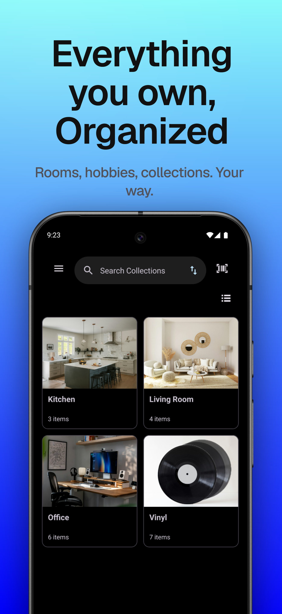
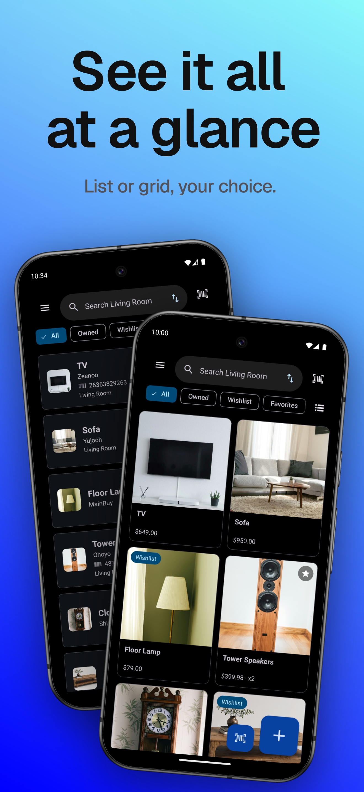
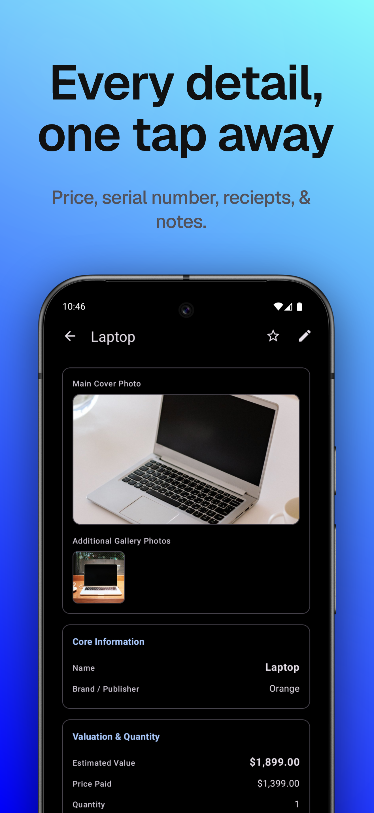

# Kept: Private Home Inventory

  
  
  

  <em>Collections (Left), items in grid and list layouts (Middle), and item details (Right).</em>

  
  &nbsp;
  
  

---

## The Problem
Whether it is a collection you love, the contents of your home for insurance, or the gear in your workshop, the details end up scattered across receipts, photos and memory. When something breaks, or you need to prove what you own, it is hard to find the model number, the serial number or the warranty date.

**Kept** puts all of it in one place, and that place is your own phone. Organize what you own into collections, scan it, photograph it and track what you paid and when the warranty ends.

---

## Features

* **Collections:** Group items into collections such as rooms, hobbies, tools or anything you like, each with its own photo.
* **Photos:** A photo for every collection and item, shown as a list or a photo grid.
* **Barcode and serial number scanning:** Scan a barcode to add an item or to find one. Search matches both barcodes and serial numbers, and a picker appears when a code matches more than one item. Scanning happens on the device.
* **Purchase and warranty details:** Model, serial number, price paid, date bought, where you bought it and warranty end date.
* **Reminders:** Get a notification before a warranty ends or an item expires (7, 14, 30 or 60 days ahead).
* **Wishlist and favorites:** Track things you want but do not own yet, and star the ones that matter, with quick filter chips.
* **Dashboard:** Item count, estimated value and total paid at a glance. Wishlist items are not counted.
* **Spreadsheet import and export:** Bring your data in from a CSV file or export everything out, so you are never locked in.
* **App lock:** Protect your collections with your fingerprint, face or screen lock.
* **Undo:** Deleted an item or a whole collection by mistake? Undo it right away.
* **Languages:** English, Spanish, German, French, Italian, Japanese and Brazilian Portuguese.

---

## Free and Pro

| Feature | Free | Pro |
|---|:---:|:---:|
| Collections | Up to 3 | Unlimited |
| Items, barcode scanning and search | ✅ | ✅ |
| Purchase, serial and warranty details | ✅ | ✅ |
| Warranty and expiry reminders | ✅ | ✅ |
| CSV import and export | ✅ | ✅ |
| App lock | ✅ | ✅ |
| Photos | One per item and collection | Extra photo gallery per item |
| PDF report with photos and values | | ✅ |
| Backup and restore to a file | | ✅ |
| Accent colors | Purple and Dynamic | Plus blue, green, orange and rose |

Pro is available as a one-time purchase or a subscription through Google Play. Your data always stays yours: if Pro ends, nothing is deleted, and you can still open and export everything.

---

## Private by Design

Your inventory never leaves your phone. Kept has no accounts, no ads and no analytics. Barcodes are read on the device with open-source software, and the only network use is Google Play Billing for the optional Pro purchase.

* [Privacy policy](https://peacefuldivide.github.io/kept-legal/)

---

## Engineering & Architecture

Kept is a native Android app written in Kotlin. The source code is not published here.

* **Architecture:** MVVM with fragment-based navigation, and Jetpack Compose for the settings, welcome tour, upgrade and barcode scanner screens.
* **Data safety:** Room with hand-written database migrations and no destructive fallback, so an app update can never wipe a user's collection.
* **On-device barcode scanning:** CameraX with the open-source zxing-cpp library. It was chosen over Google ML Kit to avoid third-party telemetry, so scanning needs no network.
* **Reminders:** A daily WorkManager job checks warranty and expiry dates and sends notifications.
* **App lock:** The AndroidX biometric library uses the system fingerprint, face or screen lock. The app never receives biometric data.
* **Licensing enforced in behavior:** Pro is checked through Google Play Billing and feeds a single flag. The last known state is cached, so a network problem never drops a paying user to the free tier, and limits are enforced in the app's logic, not just the interface.
* **Release quality:** Unit and instrumented tests, R8 code shrinking and a signed app bundle.

---

## Tech Stack

* **Language:** 100% Kotlin
* **UI:** Material Components, ViewBinding and Fragments with Navigation, plus Jetpack Compose for newer screens
* **Data:** Room (with hand-written migrations) and DataStore
* **Camera and scanning:** CameraX and zxing-cpp
* **Background work:** WorkManager
* **Security:** AndroidX Biometric
* **Billing:** Google Play Billing Library
* **Images:** Coil
* **Concurrency:** Kotlin Coroutines and Flow

---

## Distribution & Licensing

Kept is published as a managed application via **AltTab Technologies LLC** on **Google Play**, using **Google Play Billing** for secure license validation, a one-time lifetime upgrade and an optional subscription.

---

## Get Kept

* **[Get Kept on Google Play](https://play.google.com/store/apps/details?id=com.alttabtechnologies.kept)** *(Official Release)*
* Support: [support@alttabtech.com](mailto:support@alttabtech.com)

---

*Google Play is a trademark of Google LLC. Kept is not affiliated with or endorsed by Google.*

*Developed by [AltTab Technologies LLC](https://alttabtech.com)*
